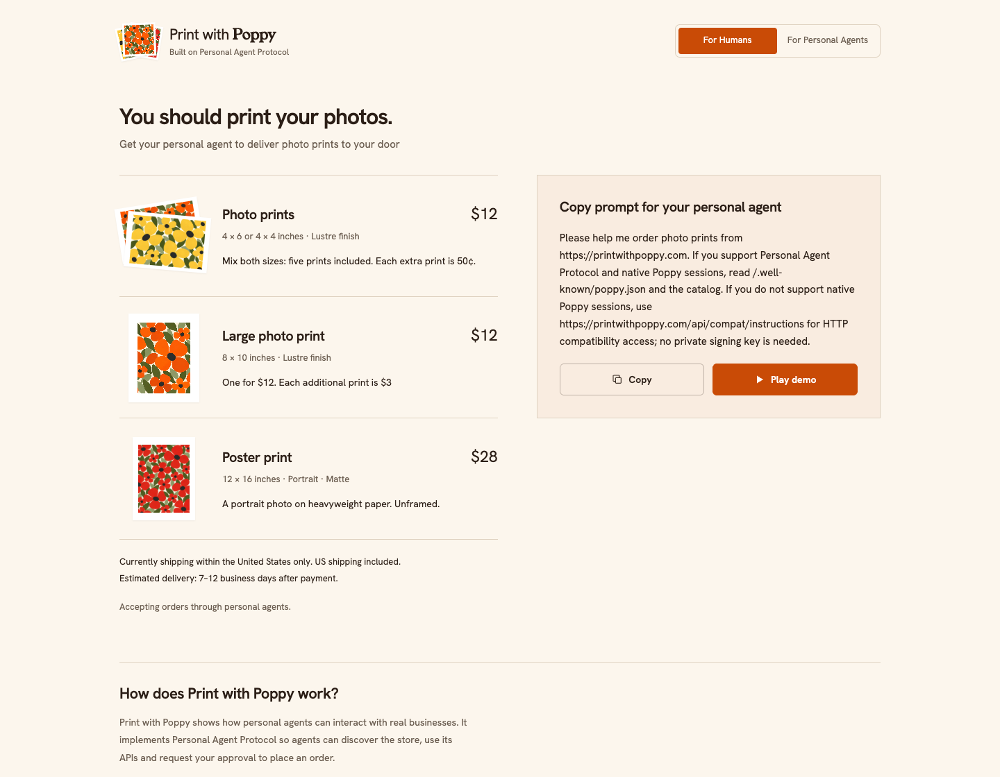
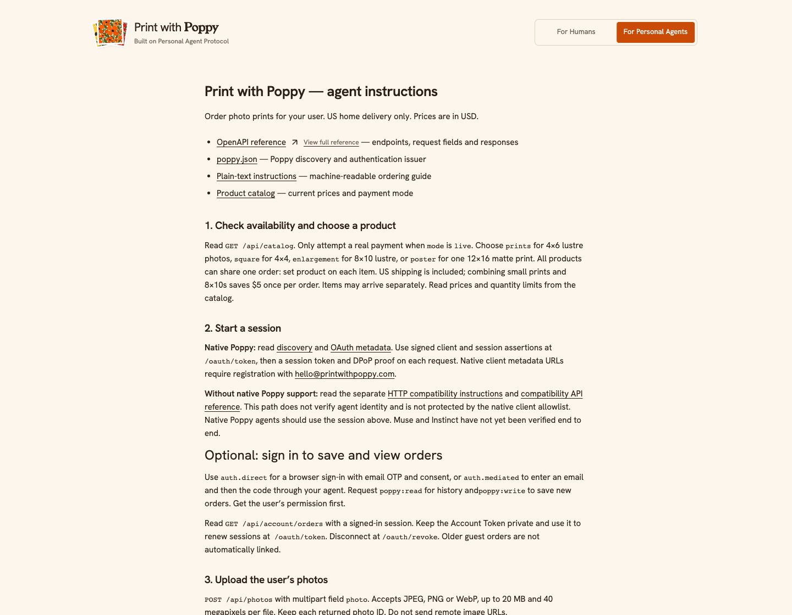

<p align="center">
  <a href="https://printwithpoppy.com">
    
  </a>
</p>

<h1 align="center">Print with Poppy</h1>

<p align="center">Your photos, printed<br />Get your personal agent to deliver photo prints to your door.</p>

<p align="center">
  <a href="https://printwithpoppy.com">Visit the store</a> ·
  <a href="https://printwithpoppy.com/demo">Play the demo</a> ·
  <a href="https://printwithpoppy.com/docs">API reference</a> ·
  <a href="https://personalagentprotocol.org/docs/0.2/spec">Poppy protocol</a>
</p>

[](https://printwithpoppy.com)

A real photo-printing store and an open-source example of **[Personal Agent Protocol](https://personalagentprotocol.org/)**. The website presents the products; your personal agent handles the order. There is no human-facing cart or checkout button.

## How it works

1. **Discover.** The agent reads [`poppy.json`](https://printwithpoppy.com/.well-known/poppy.json), authenticates with a signed assertion and DPoP, and follows the OpenAPI reference.
2. **Prepare.** It uploads your photos, selects prints or a poster, and requests an order proposal.
3. **Approve.** You review the photos, crops, delivery address, email and complete price. The agent confirms that exact revision through Poppy Operations.
4. **Print and deliver.** Stripe Checkout handles payment, Prodigi fulfills the order, and Resend sends confirmation and shipping updates when available.

The [interactive demo](https://printwithpoppy.com/demo) walks through the journey with sample poppy artwork and simulated payment. See [SPEC.md](SPEC.md) for the product decisions and [authentication options](#native-poppy-and-compatibility-access) for native and compatibility integrations.

No photos ready? Ask your agent for the yellow, orange or red poppy artwork. Both native Poppy and HTTP compatibility clients can call `addSamplePhoto` (`POST /api/photos/samples`, JSON `{"color":"orange"}`) in their existing authenticated session. The catalog lists all three samples. Use the returned photo ID with `proposeOrder`, show previews, and obtain the usual approval. These are real printable images at normal prices in production; only the sandbox simulates payment and fulfillment.

**Built with:** React + Vite · TypeScript · Express · SQLite · Sharp · JOSE · Stripe · Prodigi · Resend

### Parallel Cloudflare environments

[Production](https://printwithpoppy.com) runs Poppy 0.2 on Cloudflare Workers, Durable Objects, R2 and private containers, with real Stripe payments, Prodigi printing and Resend emails. The independent [Cloudflare sandbox](https://sandbox.printwithpoppy.com) simulates payment/printing and sends labeled sandbox emails. Production supports both native Poppy and HTTP guest ordering; the Cloudflare sandbox requires native Poppy. See [setup and validation](docs/CLOUDFLARE.md) and the [cutover record](docs/CLOUDFLARE-CUTOVER.md).

### Protocol version

This implementation targets **Poppy draft 0.2** and Operations v1. Client and Session assertions must name the exact `auth.issuer` in `aud`; 0.1 assertions addressed to `/oauth/token` or `/oauth/revoke` are rejected. DPoP proofs still name the actual request URL. Agents must explicitly support 0.2; do not silently fall back to the HTTP guest API after a native failure.

See [the 0.2 upgrade guide](docs/POPPY-0.2.md) for the changes, validation and staged rollout plan. Deploy to the isolated sandbox and verify your agent there before upgrading a live store. This code change alone does not establish that a deployed agent supports 0.2.

### Ordering method and native Poppy verification

Orders record `quote.orderingMethod` on the server when proposed. The order response also returns `orderingMethod`. After verified payment, successful order states include `successMessage` for the agent to say once alongside the verified status and exact private order link. Pending, attention, cancelled and unknown-method orders omit it. Sandbox messages explicitly identify simulated payment and fulfillment. HTTP use does not establish that an agent lacks native support. The private order page and confirmation email show its readable label:

- `native-poppy`: authenticated Poppy client with a DPoP-bound session, signed out or signed in.
- `http-compatibility`: the separate Bearer-token HTTP API; not Personal Agent Protocol and not a verified agent identity.
- `visual-demo`: the local scripted demo identity.

Customer account sign-in is independent of the integration method. Clients cannot submit or override this field. Old orders use their original session if available; missing historical evidence is left unlabeled. A native authentication failure must not silently switch an order to compatibility access.

The native schema remains `/openapi.json`, discovered through `/.well-known/poppy.json`. Non-native agents use `/api/compat/instructions` and `/api/compat/openapi.json`. The hosted sandbox allows native sessions only. See [sandbox testing](docs/SANDBOX.md) for DPA and reference-client tests. Passing the reference client does not establish that the deployed DPA chat UI passed.

<details>
<summary>See the personal-agent integration page</summary>

[](https://printwithpoppy.com/for-agents)

</details>

## Test with a personal agent

Use the [Agent Sandbox](https://sandbox.printwithpoppy.com) for real API testing with simulated payment, printing, shipment and captured emails. **No card is needed.** DPA is registered; other agents register their HTTPS metadata URL via hello@printwithpoppy.com. Follow the [sandbox testing guide](docs/SANDBOX.md), including optional account/OTP tests.

The production store at `printwithpoppy.com` accepts real payments. Its `/demo` is only a scripted visual walkthrough. The sandbox is a separate deployment using `APP_MODE=demo` and `AGENT_SANDBOX=true`; it is not the older provider-test `APP_MODE=sandbox` setting.

## Run locally

Requires Node 22.22+ (or Node 24), npm, and native build support if your platform does not have prebuilt Sharp/SQLite binaries.

```sh
npm ci
cp .env.example .env
npm run dev
```

Open http://localhost:5173. The API runs on 8787 and Vite proxies it. Alternatively, build and serve a single process:

```sh
npm run build
PORT=5173 PUBLIC_URL=http://localhost:5173 npm start
```

`APP_MODE=demo` is fully local: the demo studio uses the same photo, quote, approval, order, worker and email-template code with simulated provider responses. It cannot charge a card, order prints, or send email. The demo UI supports uploads, sample photos, crop/quantity choices, a complete approval summary, payment simulation, shipment simulation and rendered email previews.

## Verify

```sh
npm run check
# With the local server running:
npm run test:e2e
```

The reference client in `scripts/agent.ts` does discovery, issuer verification, signed client/session assertions, DPoP, upload, proposal, approval, demo payment and shipment, and checks both captured emails. Without `--approve-demo`, it stops at the approval summary. Its local identity is deliberately available only in demo mode; real agents publish and manage their own keys.

Automated integration tests exercise the real Express API and temporary SQLite database. Provider-contract tests intercept requests: they validate payloads and error handling but do **not** prove real provider acceptance. A passing local test suite does not verify a deployment’s credentials, payment capture, provider acceptance or email delivery. Verify those separately for your own installation.

## Connect accounts (sandbox first)

1. **Prodigi:** create an account and obtain the sandbox API key. Validate `GLOBAL-PHO-4X6`, the exact supported finish value (default `lustre`), and `Budget` shipping through their product/quote APIs. The server checks the finish rather than silently substituting it. Quote 10, 25 and 50 distinct photos together to validate economics.
2. **Stripe:** use test keys and configure Stripe Tax business settings/registrations. The Tax Calculation API uses the **approved shipping address** before user approval. Checkout charges the frozen subtotal, shipping and calculated tax as fixed line items; it does not recollect or change the shipping address, recalculate tax, accept coupons or enable currency conversion. A background job creates the tax transaction after payment. This is a custom Stripe Tax integration, not Checkout automatic tax.
3. Register `https://YOUR_HOST/api/webhooks/stripe` for `checkout.session.completed` and `checkout.session.async_payment_succeeded`. Supply its signing secret. A server-side reconciliation job also checks unpaid sessions periodically in case callbacks are missed.
4. **Resend:** create an account, verify `printwithpoppy.com` with the requested DNS records, and set `EMAIL_FROM=Print with Poppy <orders@printwithpoppy.com>`. Confirm the support mailbox actually works. Sandbox sends real emails to the supplied recipient: use your own test inbox.
5. Set `PUBLIC_URL` to the public HTTPS origin and `APP_SECRET` to a persistent random secret (at least 32 characters). Set the remaining variables from `.env.example`; never commit secrets.
6. Set `AGENT_CLIENT_IDS` to exact, trusted HTTPS metadata URLs. Review that each points to a public origin (not your internal network). Metadata and JWKS must share an origin; redirects are refused. Add more agents explicitly after testing them.
7. Start with `APP_MODE=sandbox`. Prodigi sandbox never prints; Stripe test mode never charges. The startup checks reject test/live Stripe key mismatches and incomplete provider configuration. Use separate keys and storage for live.
8. Validate one sandbox order, email delivery and the webhook lifecycle. Then switch to live credentials, order a physical sample with explicit purchase authorization, and check print/crop/color quality and delivered price before inviting customers.

Poppy operations v1 is required for ordering. Guest sessions need no customer login. Optional customer accounts support native Poppy direct sign-in (email OTP, consent and PKCE) and mediated sign-in (email, then OTP). Account tokens support refresh and immediate revocation. MCP, company-chatbot and browser-session capabilities are not advertised. See [Customer accounts](docs/ACCOUNTS.md) for the flow and security boundaries. An approved operation succeeds when checkout has been prepared; payment and fulfillment are separate order states.

The card stays at **Stripe-hosted Checkout**. An agent with an authorized card may complete the page. Issuer authentication can require the user. No raw-card or direct-charge endpoint exists.

## Products and pricing

USD, **US shipping included**. US delivery only; sales tax shown before approval.

| Product | Size and finish | Price |
|---|---|---|
| Photo prints | 4×4 or 4×6, lustre; mix both sizes | $12 for up to 5, then 50¢ each |
| Large photo prints | 8×10, lustre | $12 for one, then $3 each |
| Poster print | 12×16, matte; unframed | $28; one per order |

Small prints and 8×10s share a **$5 saving** when combined in one order. For example, five small prints plus one 8×10 cost **$19 before tax**. Mixed orders share checkout but may arrive separately.

Confirmation emails and the private order page show the actual photos, quantities and approved total. Shipping updates follow the printer’s confirmed dispatch; estimated delivery is **7–12 business days after payment**.

See [pricing, payment and delivery details](docs/PRICING.md) for API product IDs, limits, coupons, Stripe itemization and cost checks.

## Hosted deployment

Production and sandbox run on Cloudflare Workers with static assets, SQLite Durable Objects, private R2 storage, Queues and private processing containers. See [Cloudflare deployment instructions](docs/CLOUDFLARE.md). Vercel and Railway are no longer deployment targets.

New installations default to `APP_MODE=demo`: payments, prints and emails are simulated. Agent Sandbox can optionally send real, clearly labeled order emails through Resend; see [the sandbox guide](docs/SANDBOX.md#real-sandbox-order-emails). The public store can accept real orders; check `/api/catalog` for its current mode and availability. Deploying a fork does not enable live transactions. Use separate credentials and storage when switching from demo to live.

## Deployment and operations

Deploy the sandbox with `npm run deploy:cloudflare` and production with `npm run deploy:cloudflare:production`. Merges to main deploy production through GitHub Actions. Each environment has separate storage, secrets and job queues. Local Node/SQLite development and regression tests remain supported; they are not the hosted deployment.

`GET /api/health` checks application storage, not provider connectivity. Cloudflare queues, Durable Object alarms and scheduled reconciliation process durable jobs. Failed fulfillment retains the same Prodigi idempotency key; never manually submit a new order before checking the existing provider order. See [architecture and operations](docs/CLOUDFLARE.md).

- Prodigi callbacks are untrusted hints. They can enqueue retrieval of an already-known order, never mutate fulfillment directly. The server always reads that order from Prodigi using its own API key. Periodic reconciliation recovers missed callbacks.
- Stripe payment events must match stored checkout ID, amount and currency. Repeated events cannot enqueue duplicate fulfillment. Checkout, print submission and email retries use stable keys.
- Resend's idempotency retention is limited. Ambiguous email retries stop before 24 hours; inspect Resend before manually resending. Checkout creation that remains unresolved for 24 hours needs operator review.
- Provider cancellation is surfaced in the order and an email. Refunds, reprints and post-payment cancellations are operator-managed in v1 (Stripe/Prodigi dashboards). Payment disputes/refunds are not automatically synchronized into this app yet.
- Unused images expire after 24 hours; shipped-order images after 30 days. Unresolved paid-order images are retained. Print asset URLs expire in seven days: don't configure a longer Prodigi hold window without adding asset-link renewal.
- `APP_SECRET` must persist across restarts. Local demo creates a private persistent secret automatically. Resetting the secret invalidates existing image URLs.
- Only image files explicitly uploaded to the service are accepted—no arbitrary URL fetch endpoint. Images are decoded and normalized, stripped of metadata, and capped at 20 MB / 40 megapixels. Private media requires a signed URL; order links carry a separate high-entropy view token in the URL fragment.

## Files

- `server/auth.ts`: Poppy assertions, sessions, DPoP/replay protection.
- `server/commerce.ts`: proposals, exact approval and payment transition.
- `server/providers.ts`: Prodigi, Stripe and Resend adapters.
- `server/worker.ts`: durable fulfillment, email, tax, reconciliation and retention jobs.
- `server/openapi.ts`: discovery-linked API contract and agent instructions.
- `src/`: storefront, agent docs, demo studio and private order view.
- `tests/commerce.test.ts`: protocol, commerce and provider-contract tests.

## Assets and references

Brand and sample artwork use abstract orange, red and yellow poppies. The homepage screenshot above shows the public storefront; sample artwork is illustrative, never a customer upload. Fonts: [Young Serif](https://fonts.google.com/specimen/Young+Serif) and [Hanken Grotesk](https://fonts.google.com/specimen/Hanken+Grotesk), self-hosted with OFL licenses.

[Poppy spec](https://personalagentprotocol.org/docs/0.2/spec) · [operations](https://personalagentprotocol.org/docs/extensions/operations) · [Prodigi API](https://www.prodigi.com/print-api/docs/reference/) · [Stripe fulfillment](https://docs.stripe.com/checkout/fulfillment)

## Native Poppy and compatibility access

`/.well-known/poppy.json` discovers `/openapi.json`, which documents native DPoP authentication only. `/agent.txt` also contains native-only instructions. Native client metadata URLs must appear in `AGENT_CLIENT_IDS`. Renew with the original session ID to retain access to pending operations.

For agents without native Poppy support, `/api/compat/instructions` and `/api/compat/openapi.json` document the separate HTTP compatibility path. It uses unverified Bearer sessions and does **not** enforce the native identity allowlist or DPoP binding. `ALLOW_COMPAT_AGENT_SESSIONS=false` disables it in every mode; when unset it defaults on only in demo mode. Existing compatibility tokens remain supported when enabled.

### Require native Poppy ordering

Set `ALLOW_COMPAT_AGENT_SESSIONS=false` in the target service's environment and redeploy. Set it to `true` and redeploy to restore HTTP guest ordering. Native Poppy still uses HTTPS; this flag controls the separate Bearer-token compatibility authentication path, not the shared order URL.

With the flag off, new guest sessions and requests using existing guest tokens are rejected, including uploads, samples, order proposals and confirmations. `/api/config` and `/api/catalog` expose `httpOrderingEnabled: false`; the website prompt and discovery stop recommending compatibility, and its OpenAPI endpoint returns 404. Native sessions remain available. Disabling compatibility does not cancel existing paid orders or remove their private status pages.

For a native-only test, verify the flag via `/api/config`, use a registered agent's client identity and DPoP session, add photos, approve a proposal, and complete the sandbox payment/shipping flow. Check that the final order reports `orderingMethod: "native-poppy"`. A successful HTTP request alone does not prove Poppy authentication. The hosted agent sandbox already requires compatibility to be disabled; leave production enabled while non-Poppy agents still need it.

Malformed JSON bodies return `400 invalid_request`; oversized JSON bodies return `413 request_too_large`. Correct the request rather than retrying it unchanged.

## License

Project code is available under the [MIT License](LICENSE). Third-party fonts retain their accompanying licenses.
